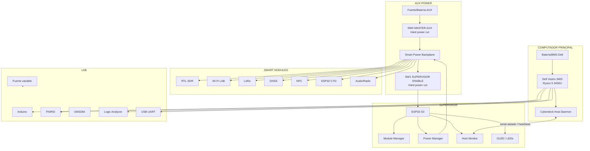

# Cyberdeck R5 + ESP32

Cyberdeck portátil modular basado en un **Dell Vostro 3405** con **AMD Ryzen 5 3450U, 12 GB RAM y SSD de 256 GB**, reutilizando pantalla, batería/BMS, teclado, touchpad, Wi‑Fi/Bluetooth, audio y refrigeración originales.

> **Estado:** arquitectura **v3 Smart Modular**. Caja objetivo: Robust MJ-5018 / Easy 16". El Dell sigue siendo un computador independiente y el resto del deck se construye como una plataforma modular supervisada.

## Idea central

El proyecto queda dividido en cuatro cerebros/capas:

- **Dell Ryzen:** computación pesada, Linux/Windows, redes, SDR, VMs y desarrollo.
- **ESP32-S3 Supervisor:** Module Manager, power manager, sensores, estado, ventilación y panel físico.
- **ESP32 CYD:** pantalla táctil/herramienta experimental independiente.
- **Arduino:** microcontrolador de laboratorio, completamente libre para prototipos.

El supervisor **NO estará encendido permanentemente por obligación**. Tendrá un interruptor físico **SUPERVISOR ENABLE** que corta realmente su alimentación.

```text
SUPERVISOR OFF
  -> ESP32 sin alimentación
  -> OLED supervisor apagado
  -> smart modules con EN por defecto en OFF
  -> Dell sigue funcionando normalmente
  -> consumo del supervisor ≈ 0; sólo queda el consumo propio de la fuente AUX si ésta sigue conectada

SUPERVISOR ON
  -> ESP32 arranca
  -> inventaría módulos
  -> detecta estado del Dell
  -> mide alimentación
  -> aplica perfil
  -> habilita sólo los módulos solicitados
```

Además existirá **MASTER AUX**, un corte físico general para apagar toda la electrónica auxiliar cuando se quiera consumo mínimo absoluto.

## Arquitectura v3



## Modularidad real

La versión pro no se limita a “módulos atornillados”. Tendremos **Smart Module Ports**.

Cada módulo compatible podrá disponer de:

- alimentación conmutable;
- `ENABLE`;
- `POWER_GOOD`;
- medición de corriente;
- identificación;
- bus I²C/UART de baja velocidad;
- línea de interrupción;
- conector desmontable;
- soporte mecánico M3.

Los módulos de alta velocidad como USB 3, HDMI, Ethernet y RF **no atraviesan nuestra PCB genérica**: usan cables/extensiones dedicadas para mantener integridad de señal.

## Smart Module Manager

El ESP32 mantiene estados como:

```text
ABSENT
PRESENT_OFF
STARTING
POWERED
ONLINE
ACTIVE
FAULT
DISABLED
```

Para módulos directos como LoRa/NFC/GNSS, el ESP32 puede verificar respuesta por bus. Para módulos USB como RTL-SDR o Wi‑Fi, Linux confirma enumeración/health mediante el Host Daemon.

## Detección del PC

Dos señales distintas:

1. **PC_PWR_SENSE:** presencia eléctrica del Dell.
2. **HOST_HEARTBEAT:** Linux confirma que el sistema operativo está vivo.

Así se puede distinguir:

```text
PWR=0                         -> PC OFF
PWR=1, HEARTBEAT=0           -> BOOTING / BIOS / HOST NO DISPONIBLE
PWR=1, HEARTBEAT=1           -> HOST ONLINE
```

## Hardware previsto

Incluye:

- doble Ethernet;
- Wi‑Fi normal + Wi‑Fi LAB;
- RTL-SDR;
- LoRa;
- GNSS/GPS;
- NFC/RFID;
- ESP32 CYD;
- RTC;
- sensores;
- Arduino GPIO;
- FNIRSI;
- GM328A;
- analizador lógico;
- USB-UART;
- fuente variable;
- USB-C PD;
- ventilación inteligente;
- radio/audio auxiliar opcional;
- control IR y conmutación de pantallas/signage propias;
- laboratorio sub-GHz opcional para dispositivos propios.

## Documentación

- `docs/01-vision.md`
- `docs/02-architecture.md`
- `docs/03-electrical.md`
- `docs/04-bom.md`
- `docs/05-mechanical.md`
- `docs/06-build-phases.md`
- `docs/07-protocol.md`
- `docs/08-comms-radio.md`
- `docs/09-instrumentation.md`
- `docs/10-assembly-map.md`
- `docs/11-smart-modules.md` — backplane, slots e identificación.
- `docs/12-supervisor-firmware.md` — Module Manager y máquina de estados.
- `docs/15-v0.1-smart-power-supervisor.md` — primer prototipo Smart Power + Supervisor.
- `docs/16-v0.1-procurement-chile-aliexpress.md` — compras V0.1 reconciliadas con el pedido real.
- `docs/17-v0.1-final-bom-checklist.md` — **BOM final V0.1, sustituciones, RILIM, capacitores y bring-up obligatorio.**
- `docs/18-display-control-ir-lab.md` — control remoto de TV/signage propio y laboratorio IR/sub-GHz.
- `docs/19-v0.1-system-architecture.md` — **arquitectura eléctrica/funcional V0.1 detallada por subsistema.**
- `docs/20-v0.1-wiring-netlist.md` — **manual pin-a-pin: nets, GPIO, cables, soldadura, conectores y test points.**
- `docs/21-portable-power-architecture.md` — **arquitectura portátil: LiFePO4, carga única, alimentación del Dell y del ESP32.**
- `TODO.md`

## Regla de construcción

**Primero banco de pruebas, después PCB, y el panel definitivo al final.**

Para la mecánica V0.1 se adopta **cartón/cartón pluma -> PVC espumado 3 mm -> PVC espumado 5 mm -> piezas definitivas**. La impresión 3D se reserva para cuando el layout y las medidas estén congelados. La carcasa exterior del maletín **no se perfora**; la bandeja se dimensionará con medidas interiores reales. Ver `docs/05-mechanical.md` y `docs/06-build-phases.md`.

La batería/BMS Dell y la motherboard no se modifican para alimentar el sistema auxiliar.
