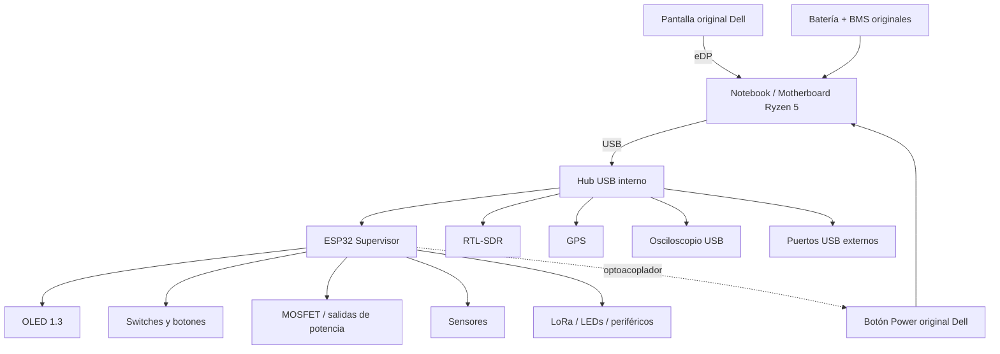

# Cyberdeck R5 + ESP32

Cyberdeck portátil basado en un notebook Dell con **AMD Ryzen 5 3450U**, reutilizando su pantalla, batería, RAM, SSD, Wi‑Fi/Bluetooth y sistema de refrigeración. Un **ESP32** funciona como supervisor de hardware, panel de control y reemplazo del GPIO que normalmente ofrecería una Raspberry Pi.

> **Estado:** diseño / prototipo. El modelo exacto del notebook donante todavía debe confirmarse antes de definir dimensiones, pinout, conectores y puntos de montaje definitivos.

## Objetivos

- Reutilizar el notebook completo como computador x86 principal.
- Mantener la batería y BMS originales del notebook sin modificar sus celdas.
- Añadir GPIO, I²C, SPI y UART mediante ESP32.
- Implementar switches físicos, pantalla de estado y control de periféricos.
- Integrar SDR, GPS, LoRa, herramientas de electrónica y puertos de panel.
- Permitir que el supervisor ESP32 permanezca activo con el PC principal apagado.
- Mantener el proyecto modular: cada subsistema debe poder probarse por separado.

## Arquitectura resumida



## Principio clave

El Ryzen hace el trabajo pesado; el ESP32 maneja el mundo físico.

```text
Ryzen 5 = Linux/Windows, SDR++, terminal, programación, VMs, juegos, red
ESP32  = GPIO, OLED, switches, LEDs, sensores, control de energía, supervisor
```

## Modos previstos

| Modo | PC Ryzen | ESP32/OLED | SDR | GPS/LoRa | Objetivo |
|---|---:|---:|---:|---:|---|
| Standby | OFF | ON | OFF | opcional | Estado, batería auxiliar y control |
| Normal | ON | ON | OFF | OFF | Uso como PC |
| Radio | ON | ON | ON | opcional | SDR / recepción |
| Dev | ON | ON | opcional | opcional | Electrónica y programación |
| Low Power | OFF | ON | OFF | opcional | Supervisión mínima |
| Gaming | ON | ON | OFF | OFF | Máximo rendimiento y menos periféricos |

## Estructura del repositorio

- `docs/01-vision.md` — alcance y decisiones de diseño.
- `docs/02-architecture.md` — arquitectura del sistema.
- `docs/03-electrical.md` — alimentación, protecciones y control.
- `docs/04-bom.md` — lista de materiales por fases.
- `docs/05-mechanical.md` — distribución física del cyberdeck.
- `docs/06-build-phases.md` — plan de construcción y pruebas.
- `docs/07-protocol.md` — protocolo PC ↔ ESP32.
- `firmware/esp32-supervisor/` — base del firmware del supervisor.
- `host/` — bridge Linux/Windows para enviar telemetría al ESP32.
- `TODO.md` — pendientes.

## Reglas de seguridad del diseño

1. **No abrir ni modificar las celdas de la batería original del notebook.**
2. Conservar su BMS, cargador, conector y cableado original.
3. No alimentar periféricos de alto consumo directamente desde GPIO del ESP32.
4. Usar MOSFETs o módulos de conmutación adecuados para cargas auxiliares.
5. Mantener fusibles en las ramas auxiliares.
6. Probar cada subsistema con fuente limitada en corriente antes de integrarlo.
7. No definir conexiones a la motherboard hasta identificar el modelo exacto y revisar su esquema/boardview si existe.

## Primera meta funcional

**MVP 1:** notebook intacto + ESP32 + OLED + switches + comunicación USB serial.

Una vez estable, se desmonta e integra en la carcasa definitiva.

## Roadmap corto

- [ ] Confirmar modelo exacto del notebook Dell.
- [ ] Medir motherboard, batería, pantalla y cooler.
- [ ] Probar notebook 100 % funcional antes de desmontar.
- [ ] Montar ESP32 + OLED en protoboard.
- [ ] Implementar telemetría PC → ESP32.
- [ ] Implementar botón power mediante optoacoplador.
- [ ] Añadir hub USB interno.
- [ ] Añadir switches y control MOSFET.
- [ ] Integrar RTL-SDR.
- [ ] Diseñar carcasa y paneles.

