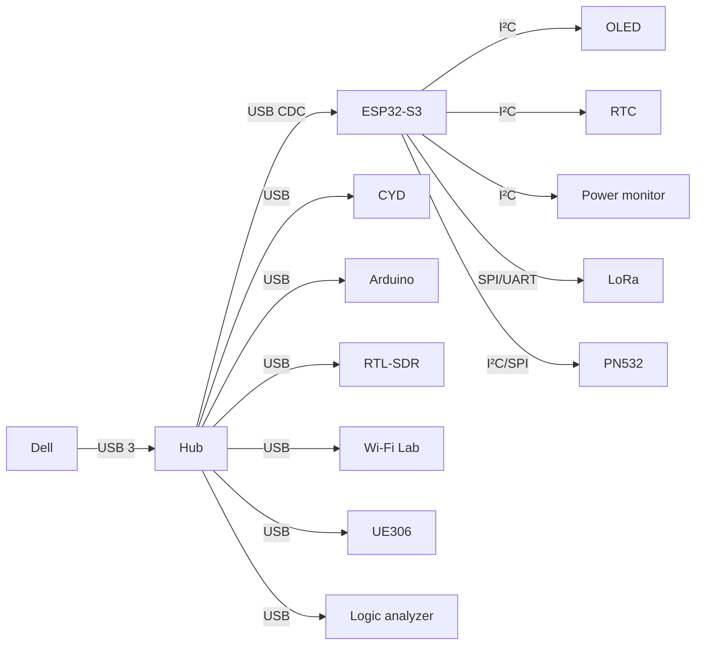

# 02 — Arquitectura del sistema

## Vista completa

```mermaid
flowchart TB
    subgraph PC["A · COMPUTADOR PRINCIPAL"]
        DELL["Dell Vostro 3405\nRyzen 5 3450U"]
        RAM["12 GB RAM"]
        SSD["SSD 256 GB"]
        LCD["LCD Dell 14\""]
        KBD["Teclado + touchpad"]
        WINT["Wi‑Fi/Bluetooth interno"]
        ETH1["Ethernet Dell"]
        BAT["Batería + BMS Dell"]
    end

    subgraph USB["B · BACKBONE USB"]
        HUB["Hub USB 3.x alimentado"]
    end

    subgraph CTRL["C · SUPERVISOR"]
        ESP["ESP32-S3"]
        OLED["OLED 1.3\""]
        RTC["DS3231"]
        SENS["BME280 / temperatura"]
        INA["INA219/INA226"]
        SWITCH["Switches + botones + encoder"]
        LOAD["Load switches / MOSFET"]
        FAN["Ventiladores auxiliares"]
    end

    subgraph AUXUI["D · INTERFAZ SECUNDARIA"]
        CYD["ESP32-2432S028R CYD\nTFT táctil + microSD"]
    end

    subgraph LAB["E · LAB ELECTRÓNICO"]
        ARD["Arduino existente"]
        TERM["Bornes GPIO"]
        PSU["Fuente variable"]
        METER["Volt/Amp meter"]
        BAN["Bornes banana"]
        SCOPE["FNIRSI-138 Pro"]
        GM["GM328A"]
        LOGIC["Logic Analyzer USB"]
        UART["USB-UART"]
    end

    subgraph COMMS["F · COMUNICACIONES"]
        WIFI2["Wi‑Fi USB dual-band\nmonitor/lab autorizado"]
        ETH2["TP-Link UE306"]
        SDR["RTL-SDR"]
        LORA["LoRa SX1262/SX127x"]
        GNSS["GNSS/GPS"]
        NFC["PN532"]
        FM["FM/Bluetooth audio opcional"]
    end

    BAT --> DELL
    RAM --> DELL
    SSD --> DELL
    LCD --> DELL
    KBD --> DELL
    WINT --> DELL
    ETH1 --> DELL

    DELL --> HUB
    HUB --> ESP
    HUB --> CYD
    HUB --> ARD
    HUB --> WIFI2
    HUB --> ETH2
    HUB --> SDR
    HUB --> GNSS
    HUB --> LOGIC
    HUB --> UART

    ESP --> OLED
    ESP --> RTC
    ESP --> SENS
    ESP --> INA
    ESP --> SWITCH
    ESP --> LOAD
    ESP --> FAN
    ESP --> LORA
    ESP --> NFC

    ARD --> TERM
    PSU --> METER --> BAN
```

## Separación de responsabilidades

### Dell

No depende del ESP32 para arrancar o funcionar. Mantiene su botón power y sistema eléctrico original. El ESP32 puede, opcionalmente, simular una pulsación mediante aislamiento, pero el botón físico original se conserva.

### ESP32-S3 supervisor

Funciones permanentes:

- leer switches;
- controlar LEDs;
- manejar ventiladores;
- mostrar estado;
- leer sensores;
- medir el rail auxiliar;
- habilitar/deshabilitar ramas con load switches;
- hablar con Linux por USB CDC/serial;
- manejar LoRa y NFC si se decide conectarlos directamente por SPI/I²C;
- emitir alarmas locales.

### ESP32 CYD

Herramienta secundaria:

- pantalla táctil;
- microSD;
- UI propia;
- firmware experimental;
- panel auxiliar.

No controla el power del Dell ni funciones críticas.

### Arduino

Se deja completamente disponible para proyectos. Su GPIO se expone en bornes y se conecta por USB al Dell.

## Buses



## RF

- Wi‑Fi de laboratorio: RP-SMA externo según el adaptador elegido.
- RTL-SDR: SMA externo.
- LoRa: SMA externo independiente.
- GNSS: antena activa/pasiva según el módulo.
- FM opcional: antena independiente.

Los coaxiales deben ser cortos y mantenerse alejados de DC/DC y cables de potencia.

## Panel de servicio

Debe existir acceso externo a:

- USB-A 3.x;
- USB-C;
- HDMI;
- audio 3.5 mm;
- LAN1;
- LAN2;
- SMA SDR;
- SMA LoRa;
- RP-SMA Wi‑Fi;
- GPIO/I²C/SPI/UART;
- bananas de fuente variable;
- power Dell;
- entrada/carga auxiliar;
- programación ESP32.
