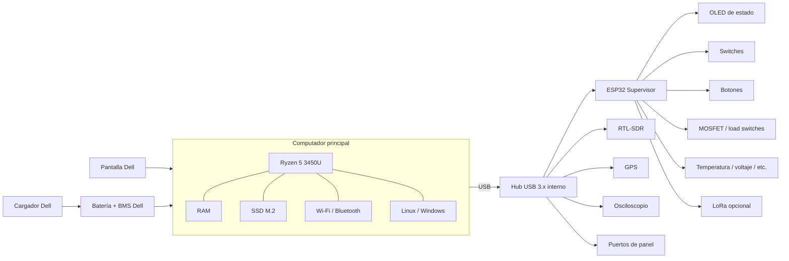

# 02 — Arquitectura del sistema

## Diagrama lógico



## Subsistema A — PC principal

Responsabilidades:

- sistema operativo;
- aplicaciones;
- SDR++/GQRX;
- Wireshark;
- IDEs y toolchains;
- máquinas virtuales;
- telemetría de CPU/RAM/SSD/red;
- interfaz de usuario principal.

## Subsistema B — ESP32 supervisor

Responsabilidades:

- lectura de switches y botones;
- actualización de OLED;
- control de LEDs;
- lectura de sensores auxiliares;
- control de ramas de energía mediante MOSFETs;
- comunicación serial USB con el PC;
- posibilidad de accionar el botón power por aislamiento óptico;
- estado mínimo independiente del PC.

## Subsistema C — expansión USB

El hub interno debe concentrar los módulos que naturalmente trabajan por USB.

Ejemplos:

- RTL-SDR;
- GPS USB;
- osciloscopio;
- adaptadores serie;
- lector SD;
- puertos externos.

Para varios periféricos simultáneos conviene un hub con alimentación externa o diseñado para suministrar corriente suficiente.

## Subsistema D — módulos de baja velocidad

Conectados al ESP32 mediante I²C/SPI/UART/GPIO:

- OLED;
- sensores;
- LoRa;
- LEDs;
- botones;
- encoders;
- relés/MOSFETs;
- medidores auxiliares.

## Encendido del PC

El ESP32 **no debe inyectar tensión** en la línea del botón power.

La opción propuesta es poner un optoacoplador o contacto aislado en paralelo con el pulsador original. El ESP32 genera un pulso corto y el circuito simula una pulsación física.

```text
ESP32 GPIO -> resistor -> optoacoplador -> contactos en paralelo al botón Dell
```

El circuito definitivo depende del diseño real del botón y debe medirse antes de conectarlo.
