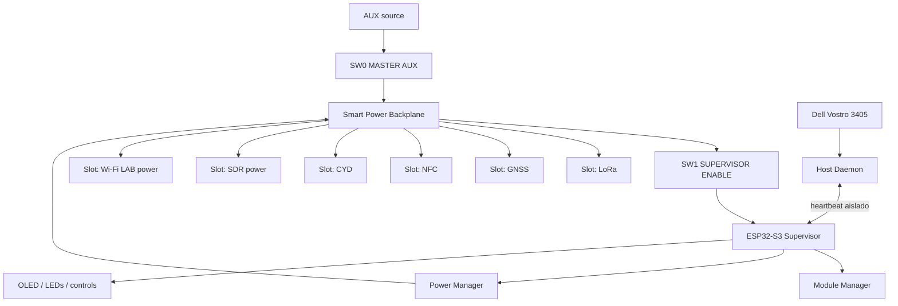
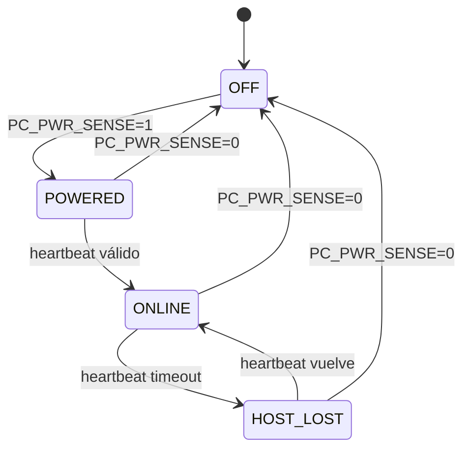
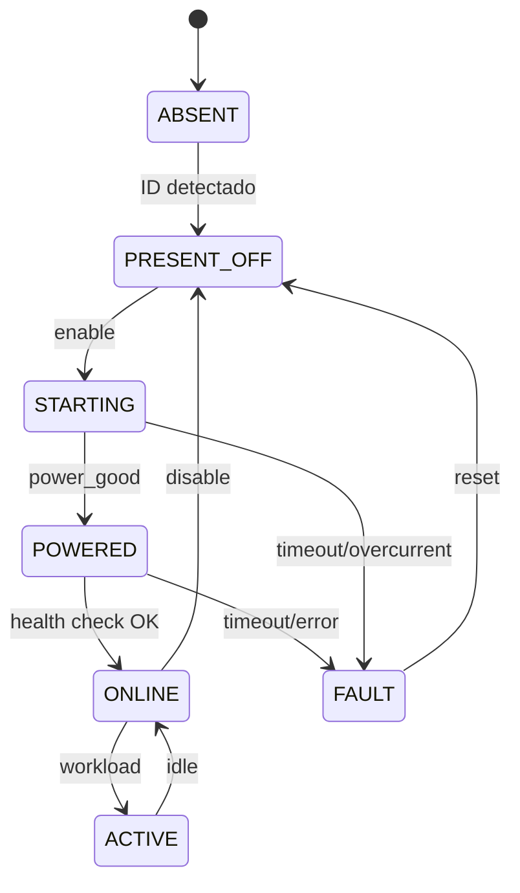

# 02 — Arquitectura del sistema v3 Smart Modular

## Principio

El cyberdeck debe funcionar incluso si el supervisor está apagado. El Dell es independiente y el subsistema AUX es opcional.



## SW0 — MASTER AUX

Interruptor físico de corte general.

OFF:

- backplane sin alimentación;
- supervisor apagado;
- ramas AUX apagadas;
- módulos AUX apagados;
- Dell sigue independiente.

Es el modo de transporte/almacenamiento y consumo auxiliar mínimo.

## SW1 — SUPERVISOR ENABLE

Interruptor físico sólo para el supervisor.

OFF:

- ESP32-S3 sin alimentación;
- OLED supervisor apagado;
- Module Manager detenido;
- todas las ramas smart tienen `EN` con pull-down hardware y quedan OFF;
- instrumentos con su propio interruptor manual siguen independientes si MASTER AUX está ON.

ON:

1. arranca el ESP32;
2. valida tensión AUX;
3. lee los Smart Module IDs;
4. detecta PC power;
5. espera/lee heartbeat;
6. aplica el perfil seleccionado;
7. habilita únicamente las ramas solicitadas.

## Estados del Dell



El supervisor no presupone que “5 V = Linux funcionando”.

## Smart Module Manager

Cada módulo tiene estado propio:



Estados mínimos:

- `ABSENT`
- `PRESENT_OFF`
- `STARTING`
- `POWERED`
- `ONLINE`
- `ACTIVE`
- `FAULT`
- `DISABLED`

## Cómo se verifica cada tipo

### Módulos conectados directamente al ESP32

Ejemplos:

- LoRa;
- PN532;
- GNSS UART;
- sensores.

El supervisor verifica respuesta real por I²C/SPI/UART.

### Módulos USB

Ejemplos:

- RTL-SDR;
- Wi‑Fi LAB;
- UE306;
- logic analyzer.

El supervisor sabe:

- si les entregó energía;
- PGOOD;
- consumo aproximado.

Cuando el Dell está ONLINE, el Host Daemon informa además si el dispositivo se enumeró y funciona.

Por eso un RTL-SDR con PC apagado puede estar `POWERED`, pero no se marca `ONLINE` sólo por consumir corriente.

## Smart Module Port

Puerto lógico de baja velocidad:

```text
3V3_ID     identificación de muy bajo consumo
5V_SW      alimentación principal conmutable
GND
ENABLE
POWER_GOOD
SDA
SCL
UART_TX
UART_RX
INT
```

No todos los pines se usan en todos los módulos.

### Identificación futura/pro

Cada carrier puede llevar una EEPROM I²C pequeña con:

```text
module_id
name
hardware_revision
driver
nominal_voltage
max_current
capabilities
```

Para permitir EEPROMs con la misma dirección en varios slots, el backplane puede usar un multiplexor I²C TCA9548A o equivalente.

Esto permite que el ESP32 detecte qué hay instalado **sin energizar el módulo principal**.

## No hot-swap por defecto

“Modular” significa reemplazable y autodetectable, no necesariamente hot-swap.

Procedimiento:

1. apagar la rama;
2. confirmar corriente ~0;
3. retirar módulo;
4. insertar módulo;
5. ejecutar rescan;
6. habilitar.

Sólo se permitirá hot-swap en un puerto específicamente diseñado para ello.

## Comunicación Host ↔ Supervisor

Producción:

```text
Dell USB -> USB-UART host -> aislador digital -> ESP32 UART
```

El aislamiento evita back-power/phantom power cuando el supervisor está físicamente apagado.

El USB-C nativo del ESP32 queda disponible como puerto SERVICE/FLASH durante desarrollo.

## Perfiles

- NORMAL
- NETWORK
- RADIO
- DEV
- LOW_POWER
- GAMING
- MANUAL

Los perfiles no sustituyen los switches físicos; establecen defaults.

Ejemplo RADIO:

```text
SDR=ON
GNSS=ON
LORA=ON
WIFI_LAB=OFF
NFC=OFF
FANS=AUTO
```

## Fail-safe

Ante reset/watchdog del ESP32:

- los enables tienen pull-down;
- módulos controlados quedan OFF;
- Dell no se apaga;
- fuente LAB conserva su interruptor OUTPUT independiente;
- ningún GPIO energiza directamente una carga.
