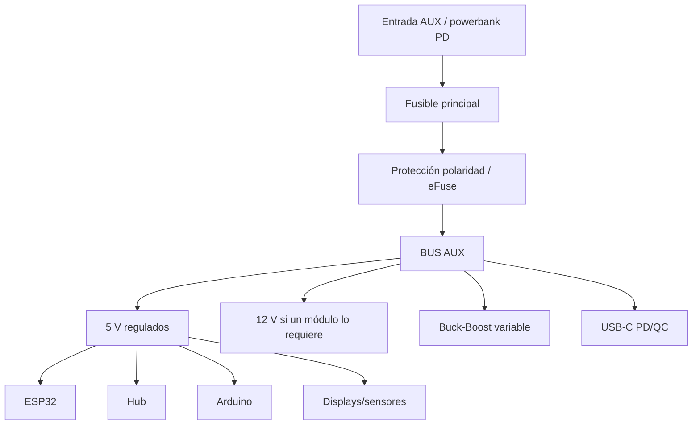

# 03 — Alimentación, protección y distribución

## Regla 1

El sistema Dell permanece intacto:

```text
Cargador Dell -> motherboard/BMS Dell <-> batería Dell -> computador
```

No abrir celdas, no puentear el BMS y no alimentar la motherboard desde una fuente DIY.

## Dos dominios de energía

### Dominio PC

Alimenta exclusivamente el Dell y sus componentes originales.

### Dominio AUX

Alimenta:

- ESP32-S3;
- ESP32 CYD;
- Arduino;
- hub USB alimentado;
- sensores;
- OLED;
- ventiladores auxiliares;
- audio/radio auxiliar;
- módulos de instrumentación cuando corresponda;
- fuente de laboratorio;
- iluminación.

Se recomienda una batería/powerbank USB-C PD protegida o una fuente auxiliar certificada, no un pack casero multicelda durante la primera versión.

## Árbol AUX



## Protección mínima

- fusible principal;
- fusibles/polyfuse por grupos;
- eFuse o protección contra inversión si la entrada no es USB-C;
- supresión transitoria apropiada;
- conectores polarizados;
- cables dimensionados por corriente;
- termorretráctil;
- masas claramente distribuidas;
- switch físico MASTER AUX;
- ventilación para DC/DC.

## Anti-backfeed USB

El hub interno debe aceptar alimentación externa correctamente y **no devolver 5 V al puerto USB del Dell**. Si el modelo elegido no garantiza aislamiento de VBUS, debe interponerse un aislador de VBUS/data cable adecuado o elegirse otro hub.

## Control de módulos

Los switches de panel son entradas lógicas:

```text
switch -> ESP32 -> driver/load switch -> módulo
```

No se usará un pequeño switch de panel para cortar directamente corrientes importantes.

Ramas previstas:

- WIFI_LAB;
- SDR;
- LORA;
- GPS;
- NFC;
- CYD;
- AUDIO;
- GPIO_LAB;
- FAN_AUX;
- LIGHTS.

## Fuente de laboratorio

Debe estar eléctricamente separada del control lógico:

```text
BUS AUX -> buck/boost regulable -> medidor V/A -> fusible de salida -> bananas +/-
```

Recomendado:

- límite de corriente si el convertidor lo soporta;
- interruptor OUTPUT;
- display V/A;
- bornes banana de 4 mm;
- fusible de salida;
- etiqueta clara del rango permitido.

## Sensado

El ESP32 puede leer:

- tensión/corriente del AUX con INA219/INA226;
- temperatura interna;
- temperatura de zona DC/DC;
- estado de ventiladores;
- presencia de alimentación;
- nivel de batería auxiliar si el sistema lo expone de forma segura.

## Refrigeración

El ventilador Dell sigue gestionado por el propio notebook.

Los ventiladores auxiliares son controlados por ESP32 mediante MOSFET/driver. Nunca bloquear rejillas inferiores del Vostro.

## Backplane v1

La PCB/backplane no transportará HDMI, USB 3 ni RF. Sólo:

- alimentación de baja tensión;
- señales GPIO;
- I²C;
- UART;
- control de ventiladores;
- entradas de switches;
- LEDs;
- salidas hacia load switches.

Conectores tentativos:

| ID | Función |
|---|---|
| J1 | AUX IN |
| J2 | 5 V BUS |
| J3 | ESP32-S3 |
| J4 | OLED |
| J5 | Switch panel |
| J6 | Fan 1 |
| J7 | Fan 2 |
| J8 | I²C expansion |
| J9 | LoRa |
| J10 | NFC |
| J11 | sensores |
| J12 | load-switch outputs |
