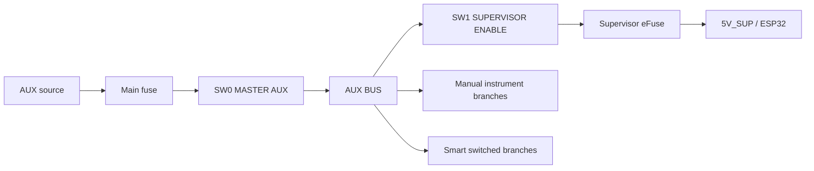

# 03 — Alimentación, protección y distribución v3

## Dos dominios independientes

### PC

```text
Cargador Dell -> motherboard/BMS Dell <-> batería Dell -> Dell
```

No se modifica.

### AUX

Alimenta todo lo añadido al cyberdeck.

## Dos cortes físicos



### SW0 MASTER AUX

Hard-off de todo el dominio auxiliar.

Debe ser un interruptor DC correctamente dimensionado para la corriente real.

### SW1 SUPERVISOR ENABLE

Hard-off dedicado al ESP32-S3 y su UI mínima.

Cuando está OFF:

- `5V_SUP = 0`;
- ESP32 realmente apagado;
- OLED del supervisor apagado;
- no hay firmware corriendo;
- smart branch enables permanecen en OFF mediante resistencias pull-down físicas.

Esto evita mantener el supervisor consumiendo energía cuando no se necesita.

> Si la fuente AUX es un powerbank, el supervisor consume prácticamente cero al estar desconectado, pero el propio powerbank puede tener un consumo de reposo interno. Para un “cero real” de todo el AUX se usa SW0 o una fuente con desconexión física compatible.

## Evitar phantom power desde el Dell

No conectar el USB del Dell de forma que pueda alimentar el ESP32 por VBUS o por pines de datos cuando SW1 está OFF.

Arquitectura de producción recomendada:

```text
Dell USB
   |
USB-UART alimentado por Dell
   |
digital isolator
   |
UART ESP32
```

El aislador debe separar ambos dominios eléctricos.

El USB-C directo del ESP32 se usa como SERVICE/FLASH y sólo se conecta cuando se trabaja sobre el supervisor.

## PC power sense

La detección del Dell debe consumir una corriente despreciable y no alimentar el supervisor.

Opciones a prototipar:

- detector de VBUS con entrada de alta impedancia;
- optoacoplador correctamente dimensionado;
- aislador/comparador dedicado.

Se seleccionará después de medir el comportamiento real de los USB del Vostro apagado, suspendido y encendido.

## Smart Power Backplane

Funciones:

- distribución AUX;
- load switches/eFuses;
- EN con pull-down;
- POWER_GOOD;
- medición de corriente;
- identificación de slots;
- fan control;
- I²C mux;
- conectores.

### Canal de módulo

```text
AUX BUS
  |
[eFuse / load switch]
  |---- PGOOD -> ESP32
  |
[current sense]
  |
5V_SW -> MODULE
```

El ESP32 sólo controla `ENABLE`; la protección contra sobrecorriente es hardware.

## Identificación con módulo apagado

Cada Smart Module Carrier puede recibir una pequeña línea `3V3_ID` desde el supervisor.

```text
3V3_ID -> EEPROM ID
5V_SW  -> electrónica principal
```

Así el EEPROM puede leerse mientras el módulo principal sigue apagado.

El consumo del ID sólo existe cuando SW1/Supervisor está ON.

## I²C

Para una versión pro:

- TCA9548A o equivalente para aislar canales;
- EEPROM 24C02/24C04 por carrier;
- OLED/RTC/INA en canal de sistema;
- módulos en canales separados.

## Monitoreo de corriente

Opciones:

- INA219/INA226 para rails importantes;
- INA3221 o equivalente para varios canales;
- load switch con fault/PGOOD.

No necesitamos medir cada LED; sí los grupos y módulos relevantes.

## Ramas smart

Planeadas:

- SDR;
- WIFI_LAB;
- LORA;
- GNSS;
- NFC;
- CYD;
- AUDIO_AUX;
- FAN_AUX;
- LIGHTS;
- AUX_SLOT_1/AUX_SLOT_2.

## Ramas manuales

Algunos instrumentos deben poder usarse aunque el ESP32 esté apagado:

- fuente LAB;
- FNIRSI si su alimentación lo permite;
- tester de componentes;
- radio/audio auxiliar.

Cada una tendrá su propio switch físico y protección.

## Fuente LAB

```text
AUX BUS
  -> fuse
  -> buck/boost CC/CV
  -> V/A meter
  -> OUTPUT switch
  -> bananas
```

No depende del ESP32 para apagar su salida.

## USB

Criterio de selección del hub:

- alimentación externa real;
- no backfeed;
- idealmente control individual de alimentación por puerto;
- documentación suficiente.

No diseñaremos un PCB USB 3 improvisado.

Para módulos USB que necesiten power switching, preferiremos:

1. hub con per-port power control;
2. módulo comercial USB power switch;
3. sólo si es necesario, control de VBUS compatible con la velocidad del enlace.

## Estado seguro al reset

Toda señal `ENABLE` lleva pull-down hardware.

Por lo tanto:

```text
ESP32 apagado/reset -> módulos smart OFF
```

La alimentación del Dell no pasa por el supervisor.
