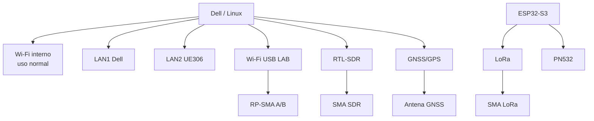
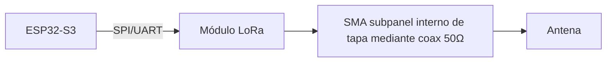

# 08 — Comunicaciones, radio y RF

**ACTUALIZACIÓN DE INGENIERÍA 17-10-2026:** el recorrido físico aprobado a nivel de arquitectura es **módulo RF en bandeja interna → coaxial de 50 Ω → conector/soporte sobre subpanel interno en la tapa → antena despejada con tapa abierta**. No se suelda RF al LCD/eDP ni se perfora el maletín impermeable. No garantiza rendimiento al 100%; SKU de antenas, extremos, banda, longitud, pérdidas y sujeción por bisagra siguen pendientes. Ver [matriz y cableado RF 26](26-lilith-switch-matrix-and-antenna-routing.md).

## Objetivo

El cyberdeck tendrá interfaces independientes para que cada tecnología tenga un trabajo claro.



## Wi‑Fi interno

Uso:

- Internet;
- SSH;
- actualizaciones;
- red habitual.

No se reserva para experimentación.

## Wi‑Fi USB de laboratorio

Requisitos:

- 2.4/5 GHz;
- soporte Linux estable;
- modo monitor cuando el driver/chipset lo permita;
- antenas desmontables;
- conexión USB;
- uso únicamente en redes propias/autorizadas.

Montaje:

- módulo dentro de zona RF;
- uno o dos pigtails cortos;
- conectores RP-SMA bulkhead **en subpanel interno de la tapa**, no a través de la carcasa impermeable. **Dos trayectos RF separados** solo si el adaptador real dispone de dos puertos (no dividir uno por splitter).

## Ethernet

### LAN1

Puerto integrado del Dell.

### LAN2

TP-Link UE306 por USB.

Casos de uso:

- red de laboratorio + red de administración;
- router/firewall experimental;
- captura/diagnóstico de redes propias;
- puente entre dos segmentos;
- VMs con interfaces dedicadas.

## RTL-SDR

Función: recepción RF de propósito general.

Arquitectura:

```text
Antena en tapa -> SMA subpanel interno -> coaxial 50 Ω flexible/medido -> RTL-SDR (bandeja) -> USB -> Linux
```

Software previsto:

- SDR++;
- GQRX;
- GNU Radio;
- rtl_433;
- herramientas de decodificación según la señal recibida.

El RTL-SDR se monta lejos de DC/DC y USB-C PD para reducir ruido.

## LoRa

LoRa será un subsistema real, no decorativo.

Hardware preferido:

- módulo basado en SX1262 o SX127x;
- interfaz SPI/UART según placa;
- antena desacoplada físicamente del módulo, en subpanel interno de tapa, desplegada al usarlo;
- conector SMA dedicado.

Usos:

- telemetría entre nodos propios;
- sensores remotos;
- mensajería LoRa;
- experimentos con Meshtastic si el hardware elegido es compatible;
- beacon/status del cyberdeck.

Arquitectura:



La frecuencia, potencia y duty-cycle deben configurarse según la normativa local antes de transmitir.

## GNSS/GPS

Uso:

- posición;
- hora UTC;
- geotagging de mediciones;
- sincronización de registros.

Preferencia:

- módulo USB para máxima simplicidad, o UART si se quiere integrar con ESP32;
- antena con vista razonable al cielo;
- conector externo si la caja degrada recepción.

## NFC/RFID

PN532 conectado al ESP32 por I²C/SPI.

Usos:

- lectura/escritura de etiquetas compatibles;
- identificación de proyectos;
- automatizaciones locales;
- laboratorio autorizado.

## Bluetooth

Se conserva Bluetooth del Dell.

El ESP32 también dispone de BLE para:

- sensores;
- control;
- pruebas IoT.

## Radio FM/Bluetooth auxiliar

Opcional tipo 808BT:

- funciona con el PC apagado;
- radio FM;
- Bluetooth audio;
- AUX;
- parlantes propios.

No es requisito para v1, pero queda contemplado mecánica y eléctricamente.

## Panel RF recomendado

```text
[RP-SMA WIFI A] [RP-SMA WIFI B]
[SMA SDR] [SMA LORA] [GNSS]
```

Cada conector debe estar rotulado para evitar conectar una antena incorrecta.


## IR / control de displays

El cyberdeck tendrá un módulo IR para laboratorio con equipos propios:

- receptor IR 38 kHz;
- LED IR 940 nm con driver por transistor;
- captura y reproducción de comandos de controles propios;
- perfiles para TV, switch HDMI y otros equipos compatibles.

Para cambiar el contenido de una TV propia usada como signage, la arquitectura preferida es **remota y sin contacto físico**:

~~~text
Cyberdeck -> Wi-Fi/Ethernet -> TV o signage player propio
~~~

Según el equipo se podrá usar Cast, DLNA, AirPlay, API/protocolo remoto del fabricante, Android/Google TV con control de red habilitado o el panel/API del reproductor signage. IR queda como fallback cuando no exista un control de red adecuado.

Detalles: [18-display-control-ir-lab.md](./18-display-control-ir-lab.md).

## Sub-GHz lab opcional

Se contempla CC1101 para pruebas autorizadas con dispositivos propios de código fijo y protocolos sub-GHz compatibles.

El RTL-SDR se mantiene como receptor de propósito general; no transmite.
