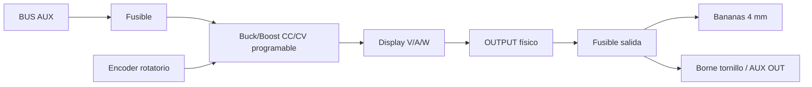

# 09 — Instrumentación y laboratorio electrónico

## Meta

Que el cyberdeck pueda usarse como banco portátil real de electrónica.

## Conjunto de instrumentos

### FNIRSI-138 Pro o equivalente

Función:

- visualizar formas de onda;
- diagnóstico básico;
- PWM;
- señales analógicas de baja frecuencia.

Debe quedar accesible desde el panel y desmontable.

### GM328A / tester de componentes

Función:

- resistencias;
- capacitores;
- diodos;
- transistores;
- MOSFET;
- otros componentes compatibles.

El zócalo ZIF debe quedar totalmente accesible.

### Analizador lógico USB

Función:

- UART;
- I²C;
- SPI;
- PWM;
- buses digitales.

Se conecta al Dell por USB y sus canales pueden salir a un header de panel.

### USB-UART

Se recomienda al menos uno y espacio para un segundo.

Función:

- consolas serie;
- ESP32/Arduino;
- routers;
- placas de desarrollo.

### Arduino

El Arduino existente queda dedicado al laboratorio.

```text
USB Dell -> Arduino -> panel GPIO -> protoboard/proyecto externo
```

No se usa para funciones críticas del cyberdeck.

## Panel GPIO

Debe exponer, según el Arduino real:

- GND;
- 5 V;
- 3.3 V sólo si la placa lo ofrece;
- GPIO digital;
- entradas analógicas;
- I²C;
- SPI;
- UART.

Usar bornes enchufables o headers claramente rotulados.

## Adaptación de niveles

El panel debe incluir o reservar espacio para:

- level shifter bidireccional 3.3/5 V;
- optoacopladores;
- resistencias serie;
- puntos GND.

Nunca asumir que un pin de 3.3 V tolera 5 V.

## Fuente regulable / Universal Power Module

Es la versión mejorada del módulo de **variable power supply** visto en el cyberdeck de referencia.



Características objetivo:

- buck-boost: poder subir o bajar tensión dentro del rango del módulo elegido;
- **CV**: fijar tensión de salida;
- **CC**: fijar límite máximo de corriente;
- encoder/perilla para ajuste;
- display de tensión, corriente y potencia;
- salida OFF independiente;
- fusible de salida;
- protección OVP/OCP/OTP cuando el módulo seleccionado la incluya.

Casos de uso:

| Carga | Salida típica |
|---|---|
| sensores/MCU | 3.3 V o 5 V |
| ESP32/Arduino externos | 5 V |
| ventiladores | 5 V / 12 V según modelo |
| servos | rail dedicado 5–6 V, corriente suficiente |
| relés/motores pequeños | según especificación |
| protoboard | variable |

**Importante:** un servo puede tener picos de corriente altos. Para servos se reserva una rama 5–6 V de mayor corriente separada del rail lógico, en vez de colgarlos del mismo 5 V que usa el ESP32.

La fuente LAB no alimenta el Dell ni reemplaza los rails fijos del Smart Backplane.

## Flujo de trabajo típico

```text
Fuente LAB -> circuito externo
Arduino -> genera señal
Osciloscopio -> mira señal analógica
Logic analyzer -> mira buses digitales
USB-UART -> consola
GM328A -> identifica componente
Dell -> programa / registra / analiza
```

## ESP32 CYD

El CYD sirve como instrumento auxiliar:

- timers;
- dashboard;
- controles táctiles;
- lectura de sensores;
- terminal de estado;
- firmware experimental.

La microSD se hará accesible con una extensión antes de considerar microsoldadura.

## Sensores integrados

Planeados:

- BME280 ambiental;
- INA219/INA226 para energía AUX;
- temperatura interna;
- temperatura cerca de DC/DC;
- opcional sensor de luz.

## Organización del panel

```text
┌────────────────────────────────────────┐
│ FNIRSI | GM328A | ESP32 CYD            │
│                                        │
│ GPIO / UART / I2C / SPI                │
│                                        │
│ V/A PSU | VOLT | OUTPUT | + | -        │
│                                        │
│ LOGIC | USB-UART | ARDUINO SERVICE     │
└────────────────────────────────────────┘
```

## Regla de montaje

Instrumentos completos se montan como módulos. No se desuelda su electrónica salvo que sea estrictamente necesario para un conector de panel y se haya documentado el pinout.

Preferencia:

1. extensión;
2. adaptador;
3. header;
4. sólo al final, soldadura directa.
