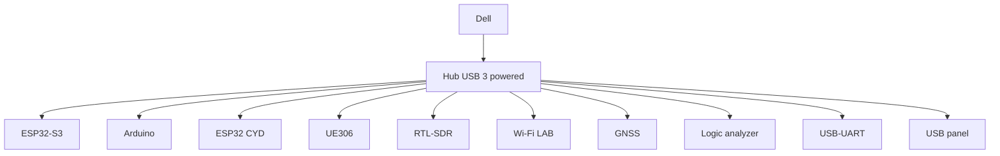
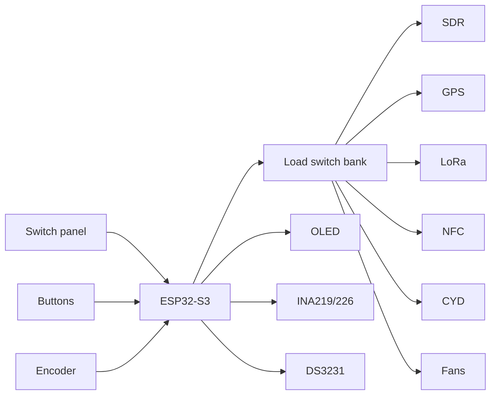

# 10 — Mapa de ensamblaje

Este documento define cómo se conecta físicamente el cyberdeck.

## Capas

### Nivel 1 — Tapa

- LCD Dell;
- webcam/mic si se reutilizan;
- OLED de estado opcional;
- parlantes auxiliares opcionales.

### Nivel 2 — Panel superior

- teclado/touchpad Dell;
- FNIRSI;
- GM328A;
- ESP32 CYD;
- GPIO;
- encoder;
- switches;
- medidor V/A;
- bananas.

### Nivel 3 — Bandeja técnica

- hub USB;
- ESP32-S3;
- Arduino;
- backplane;
- UE306;
- USB-UART;
- logic analyzer;
- RF modules;
- distribución AUX.

## Topología USB

No todos los dispositivos necesitan estar energizados a la vez. Las ramas de consumo se controlan cuando sea práctico.

## Topología de control

## Arneses

Propuesta de nombres:

| Arnés | Uso |
|---|---|
| H-PWR-01 | AUX IN -> backplane |
| H-PWR-02 | backplane -> hub |
| H-PWR-03 | backplane -> instrumentación |
| H-CTRL-01 | switch panel -> ESP32 |
| H-I2C-01 | ESP32 -> OLED/RTC/INA |
| H-FAN-01 | fan intake |
| H-FAN-02 | fan exhaust |
| H-RF-01 | Wi-Fi coax |
| H-RF-02 | SDR coax |
| H-RF-03 | LoRa coax |
| H-USB-01 | Dell -> hub |
| H-USB-02 | hub -> panel |
| H-GPIO-01 | Arduino -> terminal block |

## Qué se suelda

Sí:

- wires a switches;
- LEDs + resistencias;
- JST;
- backplane;
- load switches;
- fan headers;
- sensores;
- bananas de fuente LAB;
- cables de baja velocidad.

No:

- motherboard Dell;
- batería/celdas Dell;
- USB 3;
- HDMI;
- RJ45;
- coax RF;
- lectores microSD si una extensión sirve.

## Secuencia física de montaje

1. plantilla de cartón;
2. bandeja técnica;
3. montar módulos con standoffs;
4. arneses;
5. probar continuidad;
6. energizar AUX con fusible;
7. probar USB;
8. probar RF;
9. montar panel temporal;
10. integrar Dell;
11. pruebas térmicas;
12. recién entonces cortar panel definitivo.

## Checklist antes de cerrar

- ningún cable toca ventiladores;
- ningún coaxial pasa sobre DC/DC;
- no hay PCBs sueltas;
- fusibles identificados;
- conectores polarizados;
- cada USB está etiquetado;
- accesibles RAM/SSD;
- accesible botón power;
- ventilación libre;
- multímetro confirma tensiones;
- sin backfeed desde el hub hacia el Dell.
