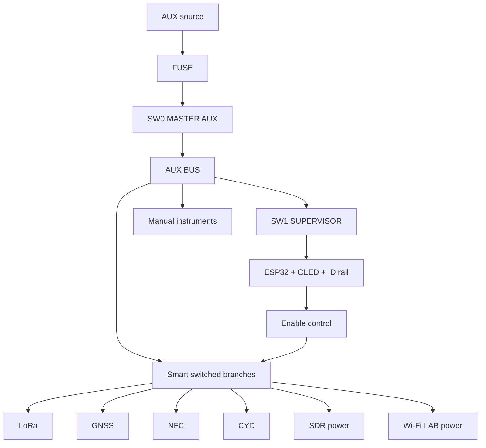

# 10 — Mapa de ensamblaje v3

## Controles de energía del panel

```text
[SW0 MASTER AUX]   [SW1 SUPERVISOR]   [DELL POWER]

SW0 OFF -> todo AUX muerto
SW1 OFF -> sólo supervisor/smart control muerto
DELL POWER -> botón Dell original
```

El Dell no depende de SW0 ni SW1.

## Capas

### Tapa

- LCD Dell;
- webcam/mic opcional;
- parlantes/estado opcional.

### Panel superior

- teclado/touchpad;
- FNIRSI;
- GM328A;
- CYD;
- GPIO;
- OLED;
- encoder;
- SW0;
- SW1;
- banco de switches de módulos;
- PSU V/A + OUTPUT;
- bananas.

### Bandeja técnica

- Smart Backplane;
- ESP32-S3;
- hub;
- Arduino;
- UE306;
- USB-UART/aislador;
- logic analyzer;
- LoRa/GNSS/NFC carriers;
- RTL-SDR;
- Wi‑Fi LAB;
- power AUX.

## Cableado de power



## Comportamiento cuando SW1 está OFF

Todos los `ENABLE` del backplane llevan pull-down físico.

Resultado:

```text
ESP32 = OFF
SMART MODULES = OFF
DELL = independiente
MANUAL INSTRUMENTS = sólo si sus propios switches están ON
```

## Comunicación Host

Producción:

```text
Dell USB
 -> USB-UART (lado Dell)
 -> digital isolator
 -> ESP32 UART
```

No conectar VBUS del Dell al rail del ESP32.

## Smart carriers

Módulos LoRa/GNSS/NFC y futuras expansiones se montan en carriers atornillados.

Cada carrier puede tener:

- EEPROM Module ID;
- connector Smart Port;
- puntos de test;
- protección local;
- conector RF cuando aplique.

USB/RF principal sigue usando cables dedicados.

## Arneses

| Arnés | Uso |
|---|---|
| H-PWR-00 | AUX -> fuse -> SW0 |
| H-PWR-01 | SW0 -> AUX BUS |
| H-PWR-02 | AUX BUS -> SW1 -> supervisor |
| H-PWR-03 | AUX BUS -> smart backplane |
| H-PWR-04 | AUX BUS -> manual instruments |
| H-HOST-01 | Dell USB-UART -> isolator |
| H-HOST-02 | isolator -> ESP32 |
| H-CTRL-01 | switches -> supervisor |
| H-I2C-01 | supervisor system I²C |
| H-FAN-01/02 | fans |
| H-RF-01 | Wi-Fi |
| H-RF-02 | SDR |
| H-RF-03 | LoRa |
| H-GPIO-01 | Arduino -> panel |

## Modularidad mecánica

Cada módulo debe retirarse con:

- tornillos;
- conector de power/control;
- cable data si aplica;
- coaxial si aplica.

No soldarlo permanentemente a la maleta.

## Qué se suelda

Sí:

- backplane;
- carriers;
- JST/terminales;
- switches;
- LEDs;
- resistencias;
- sensores;
- baja velocidad.

No:

- motherboard Dell;
- batería Dell;
- USB 3;
- HDMI;
- RJ45;
- coaxial RF.

## Orden de montaje

1. SW0 + fusible + AUX bus.
2. SW1 + supervisor aislado.
3. probar que SW1 OFF da 0 V en 5V_SUP.
4. comprobar que Dell no puede back-power el ESP32.
5. backplane con un solo canal.
6. Module ID.
7. current sense.
8. expandir a slots.
9. USB backbone.
10. RF.
11. instrumentos.
12. panel definitivo.

## Pruebas críticas

- SW0 OFF: ninguna rama AUX energizada.
- SW1 OFF: ESP32 completamente sin tensión.
- Dell ON + SW1 OFF: ESP32 sigue sin alimentación.
- SW1 ON + Dell OFF: supervisor arranca y marca PC OFF.
- SW1 ON + Dell ON sin daemon: PC POWERED.
- heartbeat activo: PC ONLINE.
- reset ESP32: enables vuelven OFF.
- módulo en fault: sólo su rama se corta.
