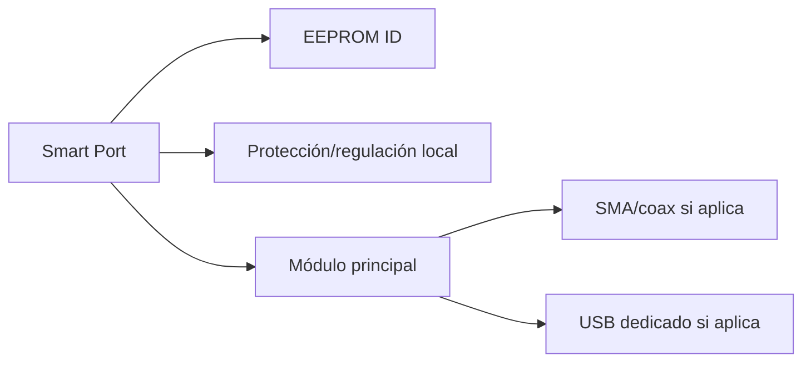

# 11 — Smart Modules / Backplane v3

## Objetivo

Que el cyberdeck sea modular de verdad:

- módulos reemplazables;
- detección de presencia;
- identificación;
- encendido individual;
- protección por canal;
- medición de corriente;
- estado y fallas;
- expansión futura.

## Filosofía

No intentamos crear un “PCIe casero”.

El Smart Module Port está pensado para **alimentación y buses de baja velocidad**. Las señales delicadas o de alta velocidad se mantienen por cable dedicado.

## Slot lógico

```text
3V3_ID
5V_SW
GND
ENABLE
PGOOD/FAULT
SDA
SCL
UART_TX
UART_RX
INT/PRESENCE
```

## Carrier

Cada módulo futuro puede vivir sobre una pequeña placa carrier.



Ejemplos:

- LoRa carrier;
- GNSS carrier;
- NFC carrier;
- sensor carrier;
- relay/output carrier;
- future AUX carrier.

## EEPROM de identidad

Campos propuestos:

```text
magic
descriptor_version
module_id
name
hardware_revision
driver
nominal_voltage
max_current_mA
capabilities
serial
```

La EEPROM se alimenta desde `3V3_ID`, no desde `5V_SW`.

Así el supervisor puede detectar el módulo antes de habilitarlo.

## I²C mux

Problema: varios carriers pueden usar la misma dirección EEPROM.

Solución:

```text
ESP32 I2C
   |
TCA9548A
   +-- CH0 slot 0
   +-- CH1 slot 1
   +-- CH2 slot 2
   +-- CH3 slot 3
   +-- ...
```

Esto también ayuda a aislar buses defectuosos.

## Secuencia de power-on

```text
1. detectar EEPROM
2. validar descriptor
3. comprobar que max_current cabe en el rail
4. ENABLE=1
5. esperar PGOOD
6. medir corriente
7. iniciar health check
8. ONLINE o FAULT
```

## Secuencia de power-off

```text
1. solicitar stop al driver
2. esperar idle
3. ENABLE=0
4. verificar corriente baja
5. estado PRESENT_OFF
```

## Power fault

Si se detecta:

- overcurrent;
- undervoltage;
- PGOOD timeout;
- temperatura anormal;

el canal se deshabilita por hardware/software y queda:

```text
FAULT
```

El resto del cyberdeck continúa funcionando.

## USB modules

Para RTL-SDR, Wi‑Fi y UE306:

- data sigue por USB dedicado/hub;
- power puede ser controlado sólo si el hardware USB elegido lo permite correctamente;
- Linux confirma enumeración;
- el supervisor no inventa “ONLINE” por consumo.

Ideal futuro:

- hub compatible con per-port power switching;
- host daemon con identificación VID/PID/serial.

## RF modules

Cada RF tiene su conector propio:

- Wi‑Fi -> RP-SMA;
- SDR -> SMA;
- LoRa -> SMA;
- GNSS -> antena GNSS.

No compartir coaxiales ni antenas a ciegas.

## Slot hot-swap

V3 se diseña como **service modular**, no hot-swap universal.

Un módulo se retira sólo cuando:

```text
POWER=OFF
CURRENT≈0
```

Un futuro slot hot-swap necesitaría:

- contactos escalonados;
- inrush limiting;
- hot-swap controller;
- ESD;
- software específico.

## Expansión futura

Reservar al menos uno o dos slots para:

- RS-485/CAN;
- environmental sensors;
- relays;
- extra LoRa;
- Zigbee/Thread;
- hardware crypto/security token;
- second GNSS;
- custom research boards.

Estos futuros módulos no obligan a rediseñar el cyberdeck completo.
