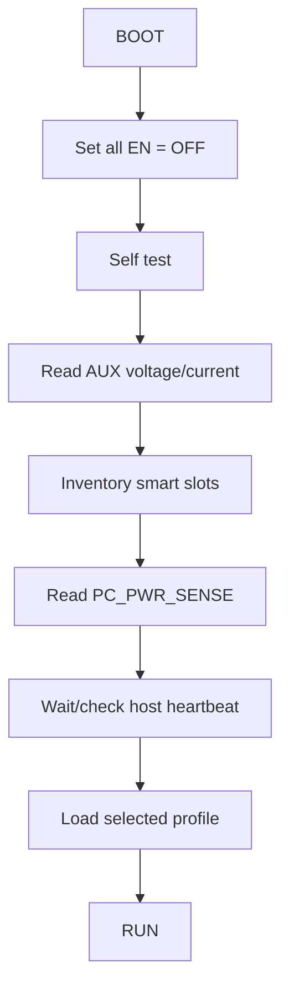
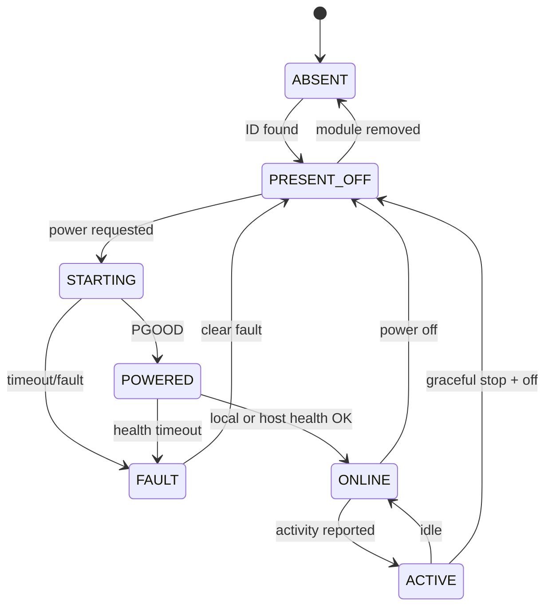

# 12 — Firmware del Supervisor v3

## Objetivo

El ESP32-S3 funciona como un pequeño BMC del cyberdeck, pero sólo cuando el usuario activa físicamente **SUPERVISOR ENABLE**.

No existe “always on” forzado.

## Boot

Al recibir alimentación:



## Componentes de software

```text
firmware/
├── app/
│   ├── main
│   └── event_loop
├── module_manager/
│   ├── inventory
│   ├── descriptors
│   ├── state_machine
│   └── health
├── power_manager/
│   ├── rails
│   ├── current_limits
│   ├── faults
│   └── sequencing
├── host_monitor/
│   ├── heartbeat
│   ├── pc_power_sense
│   └── host_messages
├── drivers/
│   ├── oled
│   ├── ina
│   ├── rtc
│   ├── bme280
│   ├── lora
│   ├── pn532
│   └── i2c_mux
├── ui/
│   ├── menu
│   ├── leds
│   └── encoder
├── profiles/
├── diagnostics/
├── storage/
└── protocol/
```

## Module record

Cada módulo mantiene:

```text
slot
id
name
state
requested_power
actual_power
power_good
current_mA
health
last_error
last_seen
host_status
capabilities
```

## Module State Machine



## Host state

```text
OFF
POWERED
ONLINE
HOST_LOST
```

Rules:

```text
PC_PWR_SENSE=0              => OFF
PC_PWR_SENSE=1 + no HB      => POWERED
PC_PWR_SENSE=1 + valid HB   => ONLINE
heartbeat timeout           => HOST_LOST
```

## Local UI

OLED default page:

```text
CYBERDECK V3
PC   ONLINE
AUX  5.08V 0.42A

SDR  OFF
LORA READY
GPS  ONLINE
WIFI OFF

TEMP 31C
```

Menu:

- Modules
- Profiles
- Power
- Network summary
- RF
- Sensors
- Faults
- Diagnostics

## Physical priority

Firmware never overrides a physical disable.

Examples:

- SW0 MASTER AUX OFF -> firmware does not exist.
- SW1 SUPERVISOR OFF -> firmware does not exist.
- branch switch OFF -> remote command cannot force ON.
- LAB PSU OUTPUT OFF -> firmware cannot energize bananas.

## Profiles

### NORMAL

Conservative defaults.

### NETWORK

Wi‑Fi LAB and networking tools ready.

### RADIO

SDR/GNSS/LoRa defaults enabled as configured.

### DEV

Arduino/GPIO/debug interfaces prioritized.

### LOW_POWER

Only supervisor + OLED minimal.

### GAMING

Auxiliary RF/instruments off; minimal background load.

### MANUAL

Physical controls determine modules.

## Event log

Store recent events:

```text
12:41:05 BOOT
12:41:06 SLOT2 LORA PRESENT
12:41:08 PC POWERED
12:41:18 HOST ONLINE
12:42:03 SDR REQUEST ON
12:42:04 SDR ONLINE
12:58:22 SLOT4 OVERCURRENT
12:58:22 SLOT4 DISABLED
```

Persistence may use NVS with write-rate limits.

## Watchdog/fail-safe

On panic/reset:

1. hardware pull-downs switch module enables OFF;
2. ESP32 reboots;
3. all channels remain OFF until inventory completes;
4. no profile automatically restores a faulted module without policy/confirmation.

## Diagnostics

Commands/pages:

- I²C scan by mux channel;
- EEPROM descriptor dump;
- PGOOD status;
- current by channel;
- host heartbeat age;
- PC power sense;
- temperatures;
- fault history;
- firmware version;
- backplane revision.

## Future

- signed module descriptors;
- OTA firmware;
- web dashboard over local network;
- MQTT/local telemetry;
- CAN/RS-485 expansion;
- capability negotiation;
- optional encrypted Host ↔ Supervisor link.
