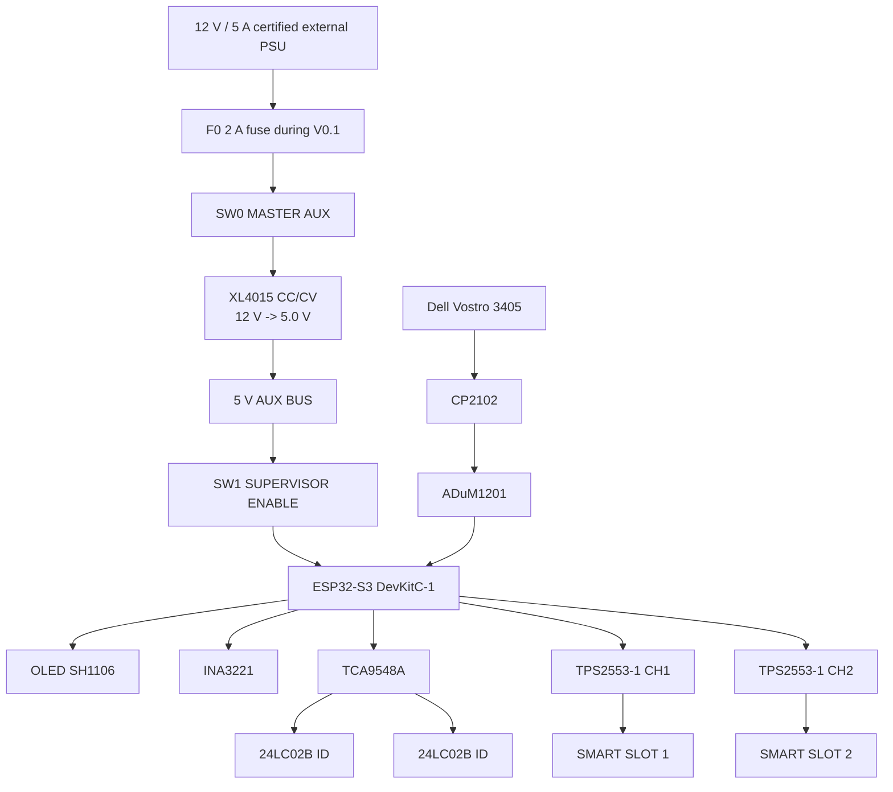

# 15 — V0.1 Smart Power + Supervisor

## Objetivo

Primera versión construible del cyberdeck v3.

La V0.1 no integra todavía SDR, LoRa, GNSS ni Wi‑Fi LAB. Primero valida el núcleo eléctrico y el supervisor para no exponer módulos caros a una alimentación insegura.

Debe demostrar:

1. entrada AUX segura;
2. hard-off MASTER AUX;
3. hard-off SUPERVISOR;
4. rail de 5 V regulado;
5. dos canales protegidos con limitación/corte de corriente;
6. medición de corriente/voltaje;
7. detección de fault;
8. identificación de módulos por EEPROM;
9. inventario por TCA9548A;
10. heartbeat Dell -> ESP32 aislado;
11. estados de módulos en OLED.

## Arquitectura



## Regla de seguridad

La V0.1 usa una fuente externa AC/DC certificada. No se trabaja con 230 V expuestos dentro de la mesa de pruebas.

La entrada de red queda confinada dentro del adaptador de escritorio.

## Fuente recomendada

**MEAN WELL GST60A12-P1J**

- 12 V;
- 5 A;
- 60 W;
- desktop enclosed;
- IEC C14;
- Level VI;
- protecciones contra short/overload/overvoltage/overtemperature;
- certificaciones internacionales del fabricante.

Para la V0.1 se limita además la entrada de nuestro circuito con un fusible de 2 A. No necesitamos 5 A durante las primeras pruebas.

## Conversión 12 V -> 5 V

Prototipo:

- XL4015 CC/CV;
- ajustar sin carga primero a 5.00 V;
- fijar current limit bajo durante bring-up;
- revisar polaridad antes de conectar el ESP32.

El XL4015 es sólo un módulo de prototipo. La PCB v1 usará un regulador/protección mejor especificado cuando conozcamos la potencia real.

## Canales protegidos

**TPS2553DBVR-1** de Texas Instruments.

Motivo:

- Vin 2.5–6.5 V;
- limitación programable;
- soft-start;
- reverse blocking;
- fault;
- latch-off en la variante -1;
- protección térmica.

V0.1 monta 2 canales aunque se compran 4 IC para repuesto/expansión.

Cada canal:

```text
5V BUS
  |
TPS2553-1
  |-- EN <- ESP32
  |-- FAULT -> ESP32
  |
INA3221/current measurement
  |
SMART SLOT
```

Los EN llevan pull-down físico.

## Smart slot V0.1

No es todavía el conector definitivo de 10 pines.

Para V0.1 usar:

- bornera o JST;
- 5V_SW;
- GND;
- SDA;
- SCL;
- UART TX/RX si hace falta;
- presence/ID.

Cada slot tendrá una 24LC02B alimentada por rail ID del supervisor.

## Host isolation

```text
Dell USB
 -> CP2102
 -> ADuM1201
 -> ESP32 UART
```

No conectar VBUS del Dell al rail del supervisor.

Objetivo de prueba:

```text
Dell ON + SW1 OFF => ESP32 sigue realmente OFF
```

## Firmware V0.1

Estados:

- ABSENT
- PRESENT_OFF
- STARTING
- POWERED
- ONLINE
- FAULT

OLED inicial:

```text
CYBERDECK V0.1
PC   OFF/ONLINE
AUX  5.01V

S0   PRESENT
S1   EMPTY

I0   0mA
I1   0mA
```

## Pruebas

### Test 1 — polarity / continuity

Sin energía.

- no corto entre 5 V y GND;
- switches correctamente cableados;
- fusible instalado.

### Test 2 — regulator

Sin ESP32.

- fuente 12 V;
- salida XL4015 ajustada a 5.00 V;
- límite de corriente bajo.

### Test 3 — supervisor hard-off

- SW0 ON;
- SW1 OFF;
- medir 0 V en 5V_SUP;
- SW1 ON;
- verificar 5 V.

### Test 4 — safe boot

Con ESP32:

- todos los EN inician LOW;
- ningún slot recibe power al boot;
- OLED funciona.

### Test 5 — channel protection

Primero usar una resistencia/carga electrónica, no un módulo caro.

- habilitar CH1;
- comprobar tensión;
- comprobar corriente;
- provocar sobrecarga controlada;
- verificar FAULT y latch-off.

### Test 6 — module ID

- conectar EEPROM al slot;
- scan por TCA9548A;
- leer descriptor;
- mostrar PRESENT_OFF.

### Test 7 — Arduino module

Usar el Arduino existente como primer módulo real.

### Test 8 — Dell heartbeat

- conectar CP2102 + aislador;
- heartbeat cada ~2 s;
- distinguir PC OFF / POWERED / ONLINE.

## Gate para pasar a V0.2

No se compran/energizan RTL-SDR, LoRa o GNSS con el backplane hasta cumplir:

- 5 V estable;
- hard-off probado;
- no phantom power;
- fault probado;
- two-slot inventory estable;
- 2 horas de funcionamiento sin calentamiento anormal.
